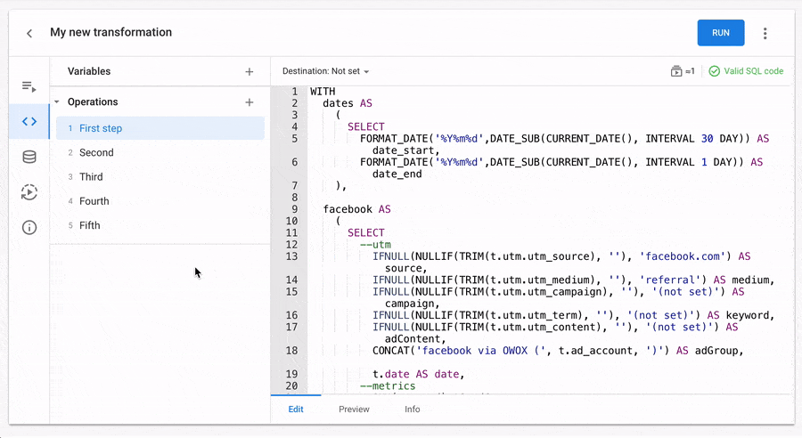
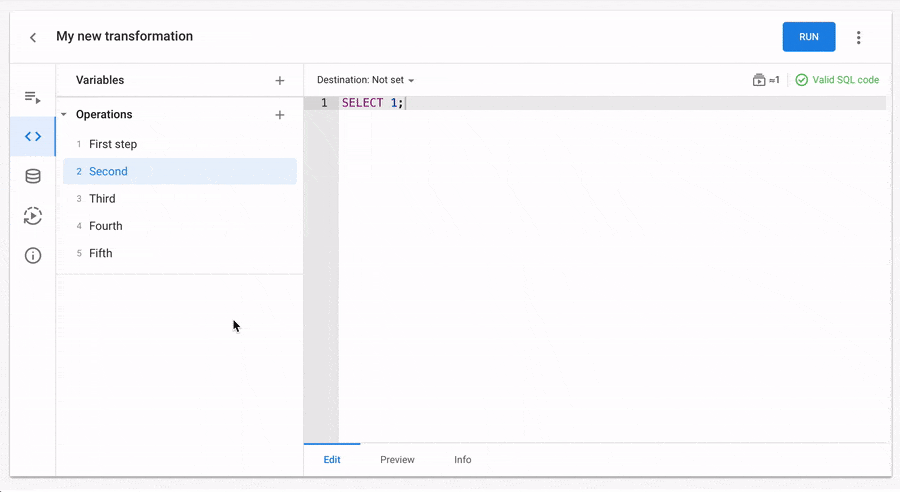
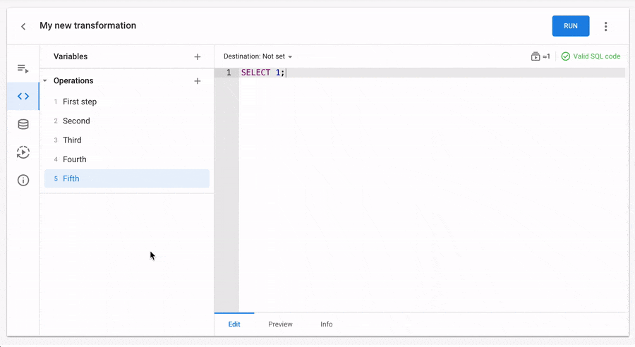

# Operation settings

- [Destination settings](#destination-settings)
- [Validations and estimations](#validations-and-estimations)
- [Creating a new Operation](#creating-a-new-operation)
- [Info tab](#info-tab)
- [How to rename an Operation](#how-to-rename-an-operation)
- [Preview tab](#preview-tab)
- [How to ignore/enable an Operation for running](#how-to-ignoreenable-an-operation-for-running)
- [How to delete an Operation](#how-to-delete-an-operation)
- [How to change the order in the list of Operations](#how-to-change-the-order-in-the-list-of-operations)

## Destination settings

The Destination settings menu is available for each Operation in the top bar above the code editor. Here you can select a Google BigQuery table where you want to save the result of the query execution.

The destination is not set by default. To open destination settings, click on the button:

You will see a popup:

### Step 1. Select writing method

Choose one of these options:

-   **Append to** — Appends the query results to an existing table.
-   **Overwrite** — Overwrites an existing table with the same name using the query results.

For more information on using query results to append to or overwrite data, see [Writing query results](https://cloud.google.com/bigquery/docs/writing-results#writing_query_results).

### Step 2. Specify the project, dataset, and table

In the “Project.dataset.table” field, specify the name of the project, dataset, and table separated by a dot. For example, 'my\_project.dataset\_name.destination\_table'.

> **Important note #1.**  
> The Google Cloud Project must be created in advance in the Google Console interface, following [this guide](https://cloud.google.com/resource-manager/docs/creating-managing-projects).

> **Important note #2.**  
> Save your changes. If a Transformation uses data from BigQuery datasets that are not accessible to OWOX BI, the Transformation cannot be successfully executed. In this case, you need to open the 'Used datasets' tab and click on the '**Share used datasets**' button. Read more in [this article](https://github.com/OWOX/transformations-plugin/blob/main/docs/transformation-settings.md#used-datasets-tab).

You can specify a non-existent table in Google BigQuery. The table will be automatically created in the selected dataset while the Transformation runs.

### Step 3 (optional). Specified advanced table options

**3.1. Table with partitioning by field**

When working with OWOX BI Transformations, you can easily save query results to BigQuery tables with partitioning. If the table does not yet exist, select the “Partitioned by field” option and OWOX BI will take care of creating the table during the Transformation run.

To do this, you need to turn on the “Partitioned by field” toggle switch and specify the field name for partitioning. This field must be of type “DATE”, “DATETIME”, or “TIMESTAMP”. Additionally, the table will be created with the "by days" partitioning type by default.

> **Important**  
> This option will be used to create the partitioned table if it does not exist during the Transformation run. If your Transformation uses an already created table with partitioning, then you do not need to specify this option.

### Step 4. Save destination

Click the “Save destination” button. The top panel of the code editor now displays the writing method with the table name.

The destination setup is complete.

## Validations and estimations

On the Transformation page, in the top toolbar, there are two indicators displayed for each Operation:

-   An approximate estimate of the Operation's run time.
-   Validation results of the SQL code.

These indicators are visible on both the 'Edit' and 'Preview' tabs.

### Validations

When you enter an SQL query in the code editor, a code validation process is triggered with a slight delay. This validation checks the syntax, and if an error is found, it will appear in the same location:

If the error message is too long, simply click on it to view the full content.

**How to pass query validation**

Please note that the SQL query in the 'Edit' tab undergoes validation based on two criteria:

-   SQL query syntax.
-   Access to BigQuery tables from which data is being queried.

If there are any errors during the validation process, you will see them in the top toolbar above the code. Fixing syntax errors and typos in the code is relatively simple if you are familiar with SQL syntax. Let's specifically address the two most common errors related to data access.

**Example of Error #1:** The specified table in the query does not exist:

In this case, there might be a typo in the project, dataset, or table name. Please check the accuracy of these expressions. If everything is specified correctly, open the BigQuery interface and see if the table has been recently deleted by mistake.

**Example #2:** The OWOX BI service account does not have access to the specified BigQuery dataset.

In this case, you need to go to the '[Shared datasets](https://bi.owox.com/ui/app/none/shared-accesses)' page and grant access to the dataset used in this transformation. Follow the instructions provided [in this article](https://www.owox.com/docs/storages/google-bigquery/) to quickly perform the necessary actions.

When the code validation is successfully passed, you will see a green mark that says "Valid SQL code." You can proceed to the next step of this instruction.

### Estimations of Operation runs

If the SQL query is successfully validated, the number of Operation runs that will be counted upon the successful execution of the Transformation is displayed next to the "Valid SQL code" mark. You can find the definition of Operation run and examples of its calculation in the [Terms of Usage](https://www.owox.com/docs/getting-started/consumption-units/).

If it is not possible to provide a preliminary estimation of the Operation run due to the validation results, a gray disabled icon without a number will be displayed in that place.

## Creating a new Operation

On the Transformation page, go to the **Code Editor** tab. You will see that the new Transformation already has the first Operation with the SQL code `"SELECT 1;"`.

Write your custom SQL code in the editor.

The entered SQL code undergoes validation to ensure that the query can be executed when the Transformation is run. If there are any errors during the validation process, you will see them in the top toolbar above the code. [In this article](https://github.com/OWOX/transformations-plugin/blob/main/docs/operation-settings.md#validations-and-estimations), you can see some examples of common errors that can occur during SQL query validation. 

When the code validation is successfully passed, you will see a green mark that says "Valid SQL code".

You can create multiple Operations in one Transformation by clicking the "+" button in the Operations section in the sidebar.

By default, all new Operations have a "SELECT 1" query. Change it for your needs. And then don't forget to save all changes.

## Info tab

Open the '**Info**' tab on the Operation page to write or read full description about current Operation.

The 'Description' field allows you to provide more information about the Operation you are working on. You can use formatted text, such as bold, italic, underline, headers, bulleted and numbered lists, links to other web pages, code snippets, quotes blocks, and more to make it easier for your teammates to understand your idea and solution.

## How to rename an Operation

In OWOX BI, renaming Operations is a quick and straightforward process. You have two methods to choose from. This article will guide you through both options.

**Method 1:** Double-click the Operation Name

1.  Open the Transformation page in OWOX BI.
2.  Double-click the Operation name to open the edit dialog.
3.  Enter the new name for the Operation.
4.  Save the changes to apply the new name.

**Method 2:** Using the Context Menu

1.  Open the Transformation page in OWOX BI.
2.  Right-click the Operation and select "Rename" from the context menu.
3.  Enter the new name.
4.  Save the changes to update the Operation's name.

## Preview tab

On the Operation page, you can view the compiled SQL code that will be executed in BigQuery when the Transformation is run.

**Features of the Preview tab**

-   The code already contains values for all variables. Here you can view the fully prepared SQL code ready for execution.
-   Editing the code on this tab is not available. However, by using the "Copy to clipboard" button, you can easily copy the entire SQL code with a single click and use it as needed.  
    
-   In the Destination table settings, you can see the actual path to the BigQuery table where your data will be saved as a result of the query execution. This is particularly useful if you are using variables in the Destination table settings.  
    The path to the Destination table is a direct link to it in the Google Cloud Console interface.  
    
-   In the Destination table settings, if a variable is not replaced with a value, you will see an error:  
    

## How to ignore/enable an Operation for running

During debugging and SQL code development, it is often necessary to run only specific Operations within a Transformation. OWOX BI provides a feature that allows you to ignore Operations during Transformation execution, enabling you to focus on developing and testing your code efficiently. This article will explain how to enable or disable the execution of Operations within a Transformation.

### How to ignore an Operation during Transformation execution

-   In the context menu of the Operation, select "Ignore for running."
-   Save the changes in the Transformation.
-   Run the Transformation, and in the logs, you will see that only active Operations are executed.

Ignored Operations can be easily identified in the Operations list as their names are displayed in a light gray color.

### How to enable an Operation for execution

-   In the context menu of the ignored operation, select "Enable for running."
-   Save the changes.
-   Start the transformation.

### Additional options in the context menu

For an even more convenient workflow, the context menu provides two additional options:

-   "Enable all operations," which activates all Operations in the list with a single click.
-   "Ignore all operations," which disables all Operations in the list with a single click.

## How to delete an Operation

In this article, we guide you through the deleting process of an Operation from your Transformation.

1.  Go to the Transformation page and find Operation that you want to delete.
2.  Hover your mouse over the name of that Operation, and you will see an icon for the context menu. Click on it.
3.  In the popup that appears, select the "Delete Operation" option.
4.  To confirm the deletion of the Operation, click the "Yes, delete Operation" button in the popup.

## How to change the order in the list of Operations

In OWOX BI, you have the flexibility to customize the order of Operations in your list. By following a few simple steps, you can rearrange the Operations to achieve the desired sequence. In this article, we will guide you through the process of changing the order of Operations in the list.

Changing the order of Operations:

1.  Open the Transformations page in OWOX BI.
2.  If the Operations list is collapsed, expand it by clicking on the corresponding section in the left sidebar.
3.  Hover your cursor over the name of the Operation you wish to move. A small icon will appear to the left of the name.
4.  Click and drag the Operation up or down to the desired position.
5.  Once you have adjusted the order of Operations, remember to save the changes in your Transformation. The Operations will now be executed in the sequence you have defined.
