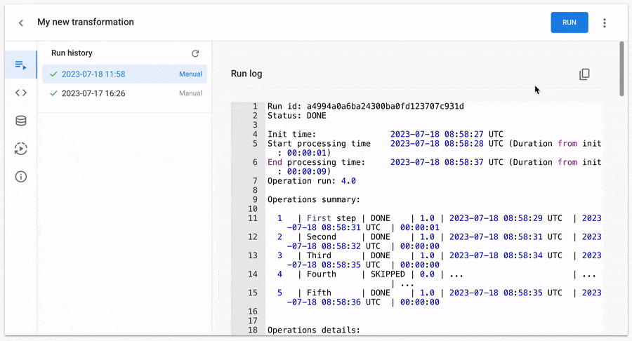
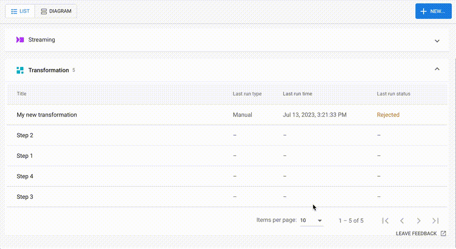

# Transformation settings

- [Dynamic Variables](#dynamic-variables)
- [Used datasets tab](#used-datasets-tab)
- [Triggers tab](#triggers-tab)
- [Creating a new Transformation](#creating-a-new-transformation)
- [Info tab](#info-tab)
- [How to stop Transformation run during execution](#how-to-stop-transformation-run-during-execution)
- [How to duplicate a Transformation](#how-to-duplicate-a-transformation)
- [How to delete a Transformation](#how-to-delete-a-transformation)
- [How to rename a Transformation](#how-to-rename-a-transformation)
- [Run history tab](#run-history-tab)
- [How to activate a blocked Transformation](#how-to-activate-a-blocked-transformation)

## Dynamic Variables

Transformation variables allow you to create special types of content that can then be referenced via a placeholder in SQL code.

### Create a Dynamic Variable

1.  Click the ‘+’ button in the variable section.  
      
      
    
2.  Choose a variable type: String, Integer, or Float.
3.  Enter a unique variable name. It should consist of alphanumeric characters and underscores, should always start with a letter, and should not have any kind of leading sigil (that is, they look like `var_name`).
4.  Enter a value.
5.  Click the ‘**Save variable**’ button.

### List of Dynamic Variables

The list of Transformation variables is displayed in the left sidebar.


**Variable highlighting in the list:**

The list of variables includes color-coded highlights to indicate their usage within the current Operation. Variables that are actively utilized in the Operation are highlighted in blue.


Variables not utilized in any Operation are displayed in light gray text.


Additionally, when you hover over a variable name, a tooltip provides information about the Operations in which the variable is utilized.


**Default values for variables in the OWOX BI template**

If you've created a Transformation from one of the templates, you will see a red highlight for variables that you need to customize:


Read more instructions about customizing templates [in this article](https://github.com/OWOX/transformations-plugin/blob/main/docs/templates/README.md#how-to-customize-a-template-in-3-simple-steps).

**Changing the order:**

You can modify the order of variables by simply clicking on the icon next to the variable name and dragging it up or down the list.


### Using Variables in SQL Code

An output statement is a set of double curly braces containing a variable name. Here is a simple example: `{{var_name}}`.

Example SQL code with variables:

```
WITH
  --Inputs
    dates AS
      ( 
        SELECT
          '{{start_suffix}}' AS s,
          '{{end_suffix}}' AS e
      ),
    streaming AS
      (
        (
          SELECT
            PARSE_DATE('%Y%m%d', _TABLE_SUFFIX) AS date,
            'site.com' AS dataSource,
            s.* EXCEPT(date)
          FROM
            dates AS d, `{{project_id}}.{{dataset_id_streaming}}.owoxbi_sessions_*` AS s
          WHERE
            _TABLE_SUFFIX BETWEEN d.s AND d.e
        )
      ),
```

When the Transformation is run, an output statement in SQL code gets replaced with the value of that variable. The compiled SQL code you can find in the “Run history” tab. Read more in [this article](https://github.com/OWOX/transformations-plugin/blob/main/docs/transformation-settings.md#run-history-tab).

### Edit Variable Settings

To edit a variable, click on it in the list. Then you can change the variables settings: type, name, and value. Click the ‘Save variable’ button to apply changes and close the popup.


### Delete Variable

To delete a variable, click on it in the list. Then click the Delete button in the opened popup. After that check, your code does not use this variable.


## Used datasets tab

The '**Used datasets**' tab displays a list of BigQuery datasets that are used in the Transformation. Here you can also check if the dataset has been granted access to the OWOX BI service account. If access is not granted, the Transformation will not run successfully. In this article, we explain how to configure access to the used datasets and successfully launch your Transformation.

### How it works

The list of used datasets is formed based on:

-   SQL code of each Operation;
-   Destination fields in each Operation.

If you create the Transformation from one of the templates, please [follow this instruction](https://github.com/OWOX/transformations-plugin/blob/main/docs/templates/README.md#how-to-customize-a-template-in-3-simple-steps) to set up Variables and share Used datasets. 

If you create the Transformation from scratch, immediately after creating the Transformation, this list of Used datasets is empty. Therefore, you will see a message on the screen, as shown in the screenshot below.


After you write the SQL code, configure the Destination, and click the '**Save transformation**' button to save your changes. The list of datasets will be updated after a successful saving of the Transformation. If there is no access to one or more datasets, you will see a warning message "No access to datasets" next to the 'Run' button after saving.


Go to the '**Used datasets**' tab to view the list of used datasets that displays:

-   Project and dataset IDs;
-   Status:
    -   ‘**No access**’ means that the OWOX BI service account does not have access to the dataset;
    -   ‘**Granted**’ means that access to the dataset is configured, and OWOX BI can read and modify data in that dataset.

By clicking on the Dataset ID, you can expand additional information about it.

For 'No access' status you will see the text message and the 'Share dataset' button:


> **Note:**  
> Every time you save changes in the Transformation, the list of datasets is updated. Be attentive when writing SQL code and avoid typos in project, dataset, and table names.

For 'Granted' status you will see the list of Operations that use this dataset and a link to the Google BigQuery interface:


### How to share BigQuery dataset with OWOX BI

If a Transformation uses data from BigQuery datasets that are not accessible to OWOX BI, the Transformation cannot be successfully executed.

To run the Transformation and obtain the execution results for each Operation, you need to grant access to all the used datasets. To do this, click on the '**Share used datasets**' button.


Open [this instruction](https://www.owox.com/docs/storages/google-bigquery/) and follow steps 4 and 5 to grant access to each dataset. You need to authenticate with a Google account that you use in BigQuery with either the '**BigQuery Admin**' or '**BigQuery Data Owner**' role.


After successful authentication, please wait while the sharing process will complete.


If everything goes smoothly, the statuses in the dataset list will be updated, and you will see green text indicating 'Granted'. If any of the datasets fail to be shared, you will be presented with an error description along with recommendations for the next steps. Example of the error description:


To view the error log click on the "?" icon. Close this popup, fix errors, and try to share the datasets again by clicking on the '**Share used datasets**' button.

When all datasets have the 'Granted' status, the red warning text next to the 'Run' button will disappear.


You are all done.

### How to use Google Sheets document as a data source for BigQuery table

If you use a BigQuery table with data from Google Sheet documents then check [this article](https://www.owox.com/docs/sources/google-sheets/).

## Triggers tab

Go to the **Triggers** tab. Add a trigger to run your Transformation automatically. Two trigger types are currently available: **Time trigger** and **Dependency trigger**.

Here you can see an empty list of triggers...


... or you can see a list of already added triggers:


You can create multiple triggers for a Transformation. Please note that each Transformation run is charged according to the terms of use. Read more in [this article](https://www.owox.com/docs/getting-started/consumption-units/).

### Time trigger

#### How to set up a Time trigger

1.  Click on the “+” button to add a new time trigger.  
    
2.  For **Time-frequency**, choose one of the following options:
    
    
    
    -   Repeated: (Default) Select the time intervals.
    -   Start every hour: Select the minute of the hour.
    -   Start every day: Select the hours, minutes, and time zone.
    -   Start every week: Select the days, hours, minutes, and time zone.
    -   Start every month: Select the days, hours, minutes, and time zone.
3.  Click the ‘**Save transformation**’ button to apply your changes.  
      
      
    

> **Important**  
> Please note: we recommend setting time triggers with a gap of five minutes or more for two different transformations, especially if they refer to the same table. This is because two simultaneous requests to the table can cause an error, resulting in the transformation not executing correctly.

#### How to disable a Time trigger

Disable the trigger using the toggle button instead of deleting it. This functionality comes in handy when you want to temporarily stop the Transformation from running automatically while you are modifying the SQL code of the Operations within it.


And don't forget to click the ‘Save transformation’ button to apply your changes.

#### How to delete a Time trigger

1.  Click on the “...” icon to open the context menu.
2.  Click the “Delete trigger” button.  
    
3.  Click the ‘**Save transformation**’ button to apply your changes.

#### How to use multiple Time triggers

You can add more than one Time trigger for each Transformation. To do this, click the '+' button and set up each trigger. The 'OR' condition is applied between multiple Time triggers.

Let's look at this example below. This means that the 'Untitled transformation' could be scheduled to run on the 1st, 10th, and 20th day of every month, **OR** it could be scheduled to start every week on Monday and Friday.


### Dependency trigger

#### How to set up a Dependency trigger

1.  Click on the “+” button to add a new Dependency trigger.  
    
2.  Click on the '+ Dependency item' button in the new trigger card.  
    
3.  In a new side popup, you can choose Transformations on which the start of the current Transformation will depend.  
      
    The launch of the current transformation will only take place once all the transformations listed in the 'Dependency items' list have been successfully executed.  
    
4.  Click the 'Save' button in the popup. And you will see the Dependency trigger setup in the card below:  
    
5.  Click the ‘Save transformation’ button to apply your changes.

#### How to disable a Dependency trigger

Disable the trigger using the toggle button instead of deleting it. This functionality comes in handy when you want to temporarily stop the Transformation from running automatically while you are modifying the SQL code of the Operations within it.


And don't forget to click the ‘Save transformation’ button to apply your changes.

#### How to delete a Dependency trigger

1.  Click on the “...” icon to open the context menu.
2.  Click the “Delete trigger” button.  
    
3.  Click the ‘Save transformation’ button to apply your changes.

#### How to use multiple Dependency triggers

You can add more than one Dependency trigger for each Transformation. To do this, click the '+' button and set up each trigger. The 'OR' condition is applied between multiple Dependency triggers.

Let's look at the example below. This means that the 'Untitled transformation' could be scheduled to run after either the 'Transformation B' and 'Transformation C' transformations **OR** after the 'Transformation F' transformation.


## Creating a new Transformation

### Step-by-step setup

1.1. Go to the [Workspace page](https://bi.owox.com/ui/app/none/workspace). Click the "**New...**" button in the top panel and choose the “Transformation” menu item.


1.2. Create a **new blank** or **template-based** Transformation. Choose one option from the list in the sidebar:


While browsing the [Templates gallery](https://github.com/OWOX/transformations-plugin/tree/main/docs/templates), you can read the detailed template description and see a list of Operations.

1.3. Click the “**Create & Setup**” button.

**You're all done!** The Transformation was successfully created.

### General info

Let's look at the Transformation page anatomy. The page consists of the following sections and elements:

1.  **The top bar** shows the Transformation title with control buttons and a button to return to the previous screen.  
      
      
    
2.  **The tab panel:** Run history, Code editor, Used datasets, Autorun triggers, and Info tabs.  
      
      
    
3.  **The tab content:** depending on the selected tab, the content of this tab is displayed in the central part of the screen.  
    

**You might be interested in...**

And now you can [rename the title](https://github.com/OWOX/transformations-plugin/blob/main/docs/transformation-settings.md#how-to-rename-a-transformation), [add Operations](https://github.com/OWOX/transformations-plugin/blob/main/docs/operation-settings.md#creating-a-new-operation), [add Variables](https://github.com/OWOX/transformations-plugin/blob/main/docs/transformation-settings.md#dynamic-variables), create [Triggers for autorun](https://github.com/OWOX/transformations-plugin/blob/main/docs/transformation-settings.md#triggers-tab), and [add a description](https://github.com/OWOX/transformations-plugin/blob/main/docs/transformation-settings.md#info-tab).

## Info tab

Open the '**Info**' tab on the Transformation page. Here you can see three inputs: Owner name, Email, and Description. With the 'Owner name' and 'Email' fields, you can easily specify who is responsible for the current Transformation, which can be helpful when working with colleagues in a team.


The 'Description' field allows you to provide more information about the Transformation you are working on. You can use formatted text, such as bold, italic, underline, headers, bulleted and numbered lists, links to other web pages, code snippets, quotes blocks, and more to make it easier for your teammates to understand your idea and solution.


## How to stop Transformation run during execution

When you initiate the execution of a Transformation in OWOX BI, a sequence of data queries is processed in BigQuery according to the defined Operations. This feature is particularly useful when you have multiple Operations and want to save resources by preventing additional query executions. This article will explain how you can use this feature to stop the execution of a Transformation.



After initiating the execution of a Transformation, the queries start running sequentially. To interrupt the execution, click on the "**Stop running**" button. Upon clicking the button, the current query being executed will be completed, but the subsequent query will not be initiated.

It's important to note that if your Transformation consists of only one Operation, there may be no need to use the "Stop running" button. However, if you have multiple Operations within the Transformation, utilizing this button can help conserve resources by preventing unnecessary query executions.

## How to duplicate a Transformation



To duplicate an existing Transformation, follow the steps below:

1.  Open the page of the Transformation you wish to reproduce.
2.  Hit the context menu icon and select "Copy transformation to clipboard."
3.  Navigate to the Workspace page and create a new blank Transformation.
4.  Find the context menu icon again and choose "Paste transformation to clipboard."
5.  The new Transformation will inherit the copied name, prefixed with "Copy of...," along with the list of variables (if any), the operations, their code, description, and Destination settings. But Triggers are not copied, so you must create a new one if you want your Transformation to run automatically.
6.  Please make any necessary changes to the new Transformation, and remember to save your changes.

By following these steps, you'll have successfully duplicated the selected Transformation in OWOX BI, allowing you to customize it for your data analysis needs.

## How to delete a Transformation

OWOX BI offers users a user-friendly interface to manage their Transformations. If you need to delete a specific Transformation, you can do so from two different locations within the product interface: the Workspace list and the Transformations page. In this article, we will guide you through the process of deleting a Transformation from both locations.

### Deleting a Transformation from the Workspace list


1\. Find in the list the Transformation that you want to delete.

2\. Click on the context menu icon.

3\. Select the "Delete Transformation" option in the popup.

4\. To confirm the Transformation deletion, click the "Yes, delete Transformation" button in the popup.

### Deleting a Transformation on the Transformations page


1\. Open the Transformation that you want to delete.

2\. Click on the context menu icon at the top of the page.

3\. Select the "Delete Transformation" option in the popup.

4\. To confirm the Transformation deletion, click the "Yes, delete Transformation" button in the popup.

### Restoring a deleted Transformation

If you accidentally delete an important Transformation and need to restore it, please contact our Support team by sending an email to [support@owox.com](mailto:support@owox.com).

## How to rename a Transformation

You can rename a Transformation, just click on the title and write a new one.


Then click outside the title area. **Save** your changes.


## Run history tab

The '**Run history**' tab is the first and default tab on the Transformation page. Here, you will find a sidebar with a list of runs and detailed information about the selected run.


### List of runs

The left menu contains the following information:

-   Run status icon:
    -   Planned;
    -   Running;
    -   Done;
    -   Failed/Error;
    -   Rejected/Canceled;
-   Date and time;
-   Run type:
    -   Manually;
    -   Scheduled by time trigger.
    -   Dependency by trigger.

To update information about running the Transformation, click on the icon.


After manually running the Transformation, the user navigates to the 'Run history' tab, where the current Run status is displayed in the sidebar and automatically updates every 5-10 seconds.


Clicking the '**View more**' button lets you easily load the next 30 runs. You can review the history of runs for **up to the past 90 days** or **at least the last 100 runs for any period**.

### Run details

Detailed information about running the Transformation is presented in three parts:

-   **Overall about Transformation:** run ID, status, and run time. This information will be helpful when contacting [bi@owox.com](mailto:bi@owox.com) if you have any questions.  
    
-   **Short overview of each Operation in the Transformation:** run ID, status, run time, and Destination settings.   
    
-   **List of Variables with values**. This log section is displayed only if variables have been created and used in the Transformation.  
    
-   **Detailed info about each Operation**: title, status, Operation ID, time start and end, duration, Operation run count, and Destination settings.  
    
-   **Compiled SQL code for each Operation:** this code executes through the Google BigQuery API, and it’s helpful for you while you are debugging.  
    

When contacting with OWOX BI Support Team, you can copy the full text of the logs by clicking on this icon:


## How to activate a blocked Transformation

When a transformation is blocked, it will display a "Blocked" label in the top bar of the Transformation page, along with a button labeled Show blocked reasons. A transformation in this status cannot be executed until the underlying issues are resolved.


### How to activate

To activate a blocked transformation, follow these steps:

1.  Click the "**Show blocked reasons**" button.
2.  **Review the listed reasons.** Each will provide specific instructions on how to resolve the issue.
3.  **Address the issues** as outlined in the instructions.
4.  **Refresh the Transformation page** after resolving the issues to ensure the status is updated.
5.  Once the transformation is active, a **Run** button will appear. Click it to start the Transformation.

By following these steps, the blocked status will be removed, and you’ll be able to run the transformation successfully.

**Example of a case when Transformations are not included in a subscription**
